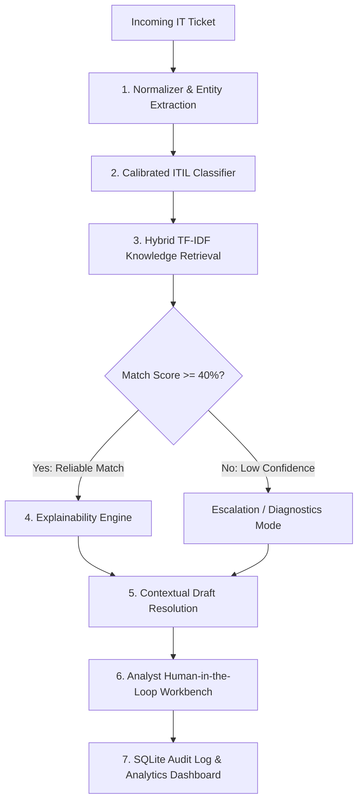

# 🎫 IT AMS — Ticket Classification and Resolution Assistant

[](https://fastapi.tiangolo.com)
[](https://react.dev)
[](https://vitejs.dev)
[](https://tailwindcss.com)
[](https://scikit-learn.org)
[](https://python.org)

An intelligent, **Human-in-the-Loop IT Service Desk Assistant** designed to help L1/L2 Application Management Services (AMS) analysts triage, classify, retrieve solutions, explain recommendations, and draft resolutions for incoming IT incidents in seconds.

---

## 📌 Problem Statement

In enterprise IT environments (ServiceNow, Jira Service Management, Zendesk), support analysts manually handle hundreds of incoming incident tickets daily. Reading unstructured user complaints, identifying error codes, finding relevant Knowledge Base (KB) articles, and drafting customer communications often takes **8–15 minutes per ticket**.

Furthermore, black-box AI generators can hallucinate or output inaccurate remediation instructions. This system combines **Hybrid TF-IDF Semantic Retrieval**, **Deterministic Error-Code Boosting**, and **Explainable AI (XAI)** guardrails to ensure fast, grounded, and safe incident resolution.

---

## 🚀 Key Features

- **7-Stage Processing Pipeline**: Full visibility into how an incoming ticket moves from raw text to a finalized customer response.
- **Regex & Entity Normalizer**: Automatic detection and extraction of system error codes (`0xC0000005`, `AUTH-403`, `554 5.2.2`, `CODE-1603`) and enterprise applications (`NovaMail`, `Atlas VPN`, `Orion HR Portal`, `Zenith CRM`).
- **Calibrated ITIL Classification**: Categorizes incidents with calibrated confidence percentages into categories (*Access & Authentication*, *Network & Connectivity*, *Software & Applications*, *Hardware*, *Email & Collaboration*).
- **Hybrid TF-IDF Knowledge Retrieval**: Computes cosine similarity over indexed KB articles boosted with error-token and application-affinity weighting.
- **Reliability Cutoff Guardrail (40% Cutoff)**: If no verified KB article meets the 40% confidence threshold, the assistant gracefully rejects false matches and triggers an escalation/diagnostic draft.
- **Explainable AI (XAI)**: Provides human analysts with clear justifications for recommendations (matched error codes, token overlap, application alignment).
- **Context-Aware Draft Resolution**: Automatically composes personalized, step-by-step resolution emails ready for analyst review and one-click dispatch.
- **Analytics & Audit Trail**: Real-time tracking of resolved tickets, time saved, category distributions, and analyst feedback stored in an SQLite audit database.
- **Interactive Lab & KB Explorer**: Test custom scenarios or browse and search standard operating procedures directly in the UI.

---

## 🧠 7-Stage Intelligence Pipeline



---

## 📂 Repository Structure

```text
├── backend/
│   ├── data/
│   │   ├── categories.json          # ITIL category taxonomy & keywords
│   │   ├── knowledge_base.json      # Standard resolution procedures & articles
│   │   ├── tickets.json             # Sample enterprise incident queue
│   │   └── audit_history.db         # Persistent resolution & analytics database
│   ├── services/
│   │   ├── normalizer.py            # Text cleaning, stop-words, regex error extractor
│   │   ├── classifier.py            # Calibrated ticket classification engine
│   │   ├── retriever.py             # Hybrid TF-IDF vectorizer + domain re-ranking
│   │   ├── explainer.py             # Transparent factor weights & justification logic
│   │   ├── draft_generator.py       # Contextual email & response synthesis
│   │   └── audit_service.py         # SQLite logging & metrics aggregation
│   ├── main.py                      # FastAPI REST application endpoints
│   └── requirements.txt             # Python backend dependencies
├── frontend/
│   ├── src/
│   │   ├── components/
│   │   │   ├── AnalyticsDashboard.jsx     # Resolution metrics & chart visualizations
│   │   │   ├── ClassificationCard.jsx     # Category predictions & confidence view
│   │   │   ├── Header.jsx                 # Navigation & quick action bar
│   │   │   ├── InteractiveLab.jsx         # Custom ticket sandbox tester
│   │   │   ├── KnowledgeArticleCard.jsx   # Top matching KB cards & comparisons
│   │   │   ├── KnowledgeBaseExplorer.jsx  # Searchable knowledge base catalog
│   │   │   ├── PipelineStepper.jsx        # Interactive 7-stage pipeline visualizer
│   │   │   ├── ResolutionEditor.jsx       # Human review, edit & dispatch panel
│   │   │   ├── TicketDetailCard.jsx       # Requester, metadata & payload preview
│   │   │   └── TicketQueue.jsx            # Filterable incoming incident list
│   │   ├── App.jsx                        # Main application orchestrator
│   │   └── index.css                      # Tailwind CSS v4 styling & theme tokens
│   ├── package.json                       # React 19 & Tailwind dependencies
│   └── vite.config.js                     # Vite build & backend API reverse-proxy
├── .gitignore                             # Ignored venv, node_modules, and cache
└── README.md                              # Project documentation
```

---

## 🛠️ Tech Stack

- **Backend**: Python 3.9+, [FastAPI](https://fastapi.tiangolo.com/), [Uvicorn](https://www.uvicorn.org/), [Pydantic v2](https://docs.pydantic.dev/)
- **Machine Learning & NLP**: [Scikit-Learn](https://scikit-learn.org/) (`TfidfVectorizer`, Cosine Similarity), [NumPy](https://numpy.org/)
- **Frontend**: [React 19](https://react.dev/), [Vite](https://vitejs.dev/), [Tailwind CSS v4](https://tailwindcss.com/), [Lucide React](https://lucide.dev/)
- **Data Persistence**: SQLite3, JSON Document Catalogs

---

## ⚡ Quick Start Guide

### 1. Prerequisites
- **Python**: 3.9 or higher
- **Node.js**: v18 or higher (with `npm`)
- **Git**

### 2. Clone the Repository
```bash
git clone https://github.com/sandhiya3711/it-ticket-booking-system.git
cd it-ticket-booking-system
```

### 3. Backend Setup
```bash
cd backend

# Create and activate virtual environment
python3 -m venv .venv
source .venv/bin/activate  # On Windows: .venv\Scripts\activate

# Install dependencies
pip install -r requirements.txt

# Start the FastAPI server
uvicorn main:app --host 127.0.0.1 --port 8000 --reload
```
The backend API and interactive Swagger documentation will be live at:
- **API URL**: `http://127.0.0.1:8000`
- **Swagger Docs**: `http://127.0.0.1:8000/docs`

### 4. Frontend Setup
In a new terminal window:
```bash
cd frontend

# Install npm dependencies
npm install

# Start Vite development server
npm run dev
```
The frontend application will be live at:
- **Frontend URL**: `http://localhost:5173`

*(Note: The Vite dev server automatically proxies `/api` calls directly to `http://localhost:8000`)*

---

## 📡 REST API Reference

| Method | Endpoint | Description |
| :--- | :--- | :--- |
| `GET` | `/api/health` | Healthcheck endpoint |
| `GET` | `/api/tickets` | List incoming tickets with filtering by type, category, or search |
| `GET` | `/api/tickets/{ticket_id}` | Retrieve details for a specific ticket |
| `POST` | `/api/pipeline/process` | Run the complete 7-stage processing pipeline on a ticket |
| `POST` | `/api/tickets/resolve` | Approve, escalate, or reject a ticket resolution and write to audit log |
| `GET` | `/api/knowledge-base` | Search and filter knowledge base articles |
| `GET` | `/api/categories` | Retrieve available ITIL categories and subcategories |
| `GET` | `/api/analytics` | Fetch resolution volume, category breakdown, and time saved |
| `POST` | `/api/feedback` | Record analyst rating (`accurate`, `inaccurate`, `needs_refinement`) |

---

## 🔒 Safety & Reliability Guardrails

1. **No Hallucinations**: Resolution procedures are directly grounded in indexed standard operating procedures.
2. **Confidence Thresholding**: Prevents false recommendations on unsupported issues by requiring >= 40% similarity.
3. **Analyst Editorial Control**: The AI provides a draft; the analyst retains final authority to modify, escalate, or approve.

---

## 📄 License
This project is open-source and available under the [MIT License](LICENSE).
